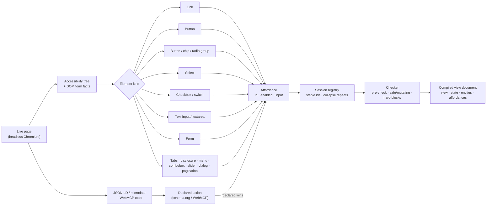

# interface-compiler

**Compile any website into an agent-usable interface with typed, checked actions.**

> Status: **pre-alpha, under construction.** This README is the skeleton the build fills in. Sections marked `TODO(Mx)` are completed at build milestone `Mx` in [`PLAN.md`](PLAN.md) using real output, never invented output. No numbers are claimed until the evals have run.

`interface-compiler` opens a public web page in a headless browser and turns what a person would see (buttons, links, forms, dropdowns, tabs, menus) into a **compiled view document**. This is a small JSON object that answers the two questions an agent asks at every step: *what is true right now*, and *what may I do next*.

Chromium's sandbox is required and on by default.

```json
{
  "view": "product",
  "state": {"selected_size": "L", "cart_count": 1},
  "entities": {"product": {"id": "tee-navy", "name": "Navy Crew Tee", "price": 28}},
  "affordances": [
    {"id": "set_size", "enabled": true,
     "input": {"type": "object", "properties": {"size": {"type": "string", "enum": ["S", "M", "L"]}}, "required": ["size"]}},
    {"id": "add_to_cart", "enabled": true, "input": {"type": "object", "properties": {}}},
    {"id": "go_checkout", "enabled": true, "input": {"type": "object", "properties": {}}}
  ]
}
```

It is served to agents as an **MCP server** (stdio or local Streamable HTTP) and a thin **HTTP API**, and there is a **CLI** (`interface-compiler open <url>`). It is free: no paid APIs, and optional small local models only.

---

## Contents

- [Why not just give the agent the page?](#why-not-just-give-the-agent-the-page)
- [How page elements become actions](#how-page-elements-become-actions) ← the core idea
- [Before and after: one real page](#before-and-after-one-real-page)
- [The compiled view document](#the-compiled-view-document)
- [Install](#install)
- [Use it from an agent (MCP)](#use-it-from-an-agent-mcp)
- [HTTP API](#http-api)
- [Safety model](#safety-model)
- [What it cannot know](#what-it-cannot-know)
- [Evaluation](#evaluation)
- [Relation to the paper](#relation-to-the-paper)
- [Development](#development)

---

## Why not just give the agent the page?

Agents today mostly read a screenshot, raw HTML, or an accessibility-tree snapshot, such as the one [Playwright MCP](https://github.com/microsoft/playwright-mcp) returns. Those work, but they hand the model a *page* and leave it to work out what is possible:

| | Accessibility snapshot (e.g. Playwright MCP) | Compiled view document |
|---|---|---|
| Action names | per-snapshot refs (`e5`), invalid once the page changes | stable, task-level ids (`add_to_cart`, `open_product`) that survive reloads |
| Is it allowed now? | a `disabled` attribute at best | `enabled` on every action, with a reason (`"missing: size"`, `"blocked by dialog"`, `"requires sign-in"`) |
| Arguments | free text typed into fields | a JSON Schema per action (types, `required`, `enum`, `pattern`, `min`/`max`), checked **before** anything is clicked |
| What is on screen | everything, interleaved with controls | `state` (current values, counters) and `entities` (products, results, rows) kept apart from actions, 10 per list |
| Did it work? | the agent must re-read and guess | every `act` returns an **effect check**: predicted vs observed, plus any blocked requests |
| Side effects | clicks go straight through | actions are tagged `safe` / `mutating`; mutating ones need a confirm token; checkout, pay, delete and send are blocked |
| Size | tracks page size | tracks what is on the current screen. `TODO(M5)`: measured token ratio |

## How page elements become actions

This is the heart of the project. Every interactive element on the page goes through **one small, tested mapping function for its kind**. Each function returns an *affordance* with exactly three things:

1. an **`id`**: a task-level `verb_object` name, never a DOM path;
2. **`enabled`**: is it worth attempting right now, plus a reason when it isn't;
3. **`input`**: a JSON Schema for its arguments, read from the HTML's own constraints.



### The mapping, kind by kind

| Element on the page | Becomes (`id`) | `enabled` is false when… (`x.reason`) | `input` schema | Also writes |
|---|---|---|---|---|
| **Link** | `go_<view>` (e.g. `go_cart`, `go_checkout`) | hidden, inert, covered, or behind a login | `{}` | — |
| **Repeated links** (cards, rows, results) | ONE `open_<entity>` per entity type, e.g. `open_product` | no visible items | `{"product_id": string}`, required | `entities.products` (10 per page) |
| **Button** (outside a form) | a verb: `add_to_cart`, `show_more`, `sign_in`, … | `disabled`, `aria-disabled`, hidden, covered by a dialog, behind a login | `{}` | pressed state, if a toggle |
| **Button / chip / radio group** | `set_<field>`, e.g. `set_size` | no available option | `{"size": {"enum": [enabled options]}}`; sold-out and disabled options are dropped | `state.selected_size` |
| **Select / dropdown** | `set_<field>` | no available option | `enum` of enabled options. A custom dropdown whose options are hidden in a **closed** menu → free-text `string` | `state.selected_<field>` |
| **Checkbox / switch** | `set_<field>` | disabled | `boolean` | `state.<field>` |
| **Text input / textarea** (on its own) | `set_<field>` | disabled, read-only | `string` / `number` with `format`, `pattern`, `minLength`/`maxLength`, `minimum`/`maximum` from the HTML | `state.<field>` |
| **Form** | `search` (search forms), a verb (`subscribe`), or `submit_<form>`; its fields become properties | submit disabled | all fields as properties; `required` from the HTML | current values → `state` |
| **Form of choices + one action** (e.g. size + Add to cart) | `set_<field>` per control + the verb with `{}` | the verb, while the browser's own validation fails: `"missing: size"` | per control | `state.selected_<field>` |
| **Tabs** | `open_tab` | no enabled tab | `{"tab": {"enum": [...]}}` | `state.selected_tab` |
| **Disclosure / accordion** | `toggle_<section>` | disabled | `{}` | `state.<section>_expanded` |
| **Menu** | `open_menu`, plus each item by its own kind | items: `"menu closed"` until opened | `{}` | `state.<menu>_menu_open` |
| **Combobox / listbox** | `set_<field>` | disabled | `enum` if the options are visible now, else `string` | `state.<field>` |
| **Slider / spinbutton** | `set_<field>` | disabled | `number` with min/max/step | `state.<field>` |
| **Open modal dialog** | its own controls + `close_dialog` | everything else: `"blocked by dialog"` | — | `state.dialog_open` |
| **Pagination** | `next_page`, `prev_page`, `go_page` | no next/previous page | `go_page`: `{"page": {"enum": [visible pages]}}` | `state.page` |
| **schema.org action** (JSON-LD `potentialAction`) | e.g. `SearchAction` → `search` | (declared, so it wins over inferred) | from the declared inputs | — |
| **WebMCP tool** (registered by the page) | the tool's name in snake_case | (declared) | the tool's own input schema | — |

Some rules apply everywhere:

- Ids stay the same across reloads and look-to-look.
- Actions on a later step of a flow (address, payment, pay) are not listed until you reach that step.
- Anything that only works when signed in is listed as `enabled: false` with `"requires sign-in"`.

The full rules, with the exact precedence, are in [`PLAN.md` §5](PLAN.md) and [`docs/PAPER-REQUIREMENTS.md`](docs/PAPER-REQUIREMENTS.md).

### One page, end to end

The target shape is the product page from the paper's MiniShop store (§4.1): what a shopper sees, and what an agent gets. Here the shopper has picked size L and added the tee to the cart.

| On the page | In the compiled view document |
|---|---|
| Product title "Navy Crew Tee", price $28 (with JSON-LD `Product`) | `"view": "product"`, `entities.product = {"id": "tee-navy", "name": "Navy Crew Tee", "price": 28}` |
| Size picker S / M / L / ~~XL (sold out)~~, L selected | `set_size` with `"enum": ["S","M","L"]` (XL dropped), `state.selected_size = "L"` |
| **Add to cart** button (disabled until a size is picked) | `add_to_cart`, `enabled: true` now; it would be `false` with `"missing: size"` before a size was chosen |
| Cart badge showing **1** | `state.cart_count = 1` |
| "Back to catalog" link, "Checkout" link | `go_catalog`, `go_checkout` (`{}` inputs) |
| "You may also like" product cards | one `open_product(product_id)`, with the cards in `entities` |
| (Address form and Pay button live on the checkout page) | not listed here: they are later flow steps (in the paper's own printout they appear as `enabled: false`) |

`TODO(M4)`: add the same two-column walk-through for a **real public page**, generated by `interface-compiler open <url>` and pasted verbatim, with the elements highlighted on a screenshot.

## Before and after: one real page

`TODO(M4)`: replace this block with real output, both generated by commands, never hand-written:

```bash
interface-compiler raw  https://docs.python.org/3/library/json.html   # BEFORE: accessibility snapshot
interface-compiler open https://docs.python.org/3/library/json.html   # AFTER: compiled view document
```

| | Before (accessibility snapshot) | After (compiled view document) |
|---|---|---|
| Tokens (o200k_base) | `TODO(M4)` | `TODO(M4)` core + `TODO(M4)` for `x` |
| Actions an agent can name | `TODO(M4)` | `TODO(M4)` |

## The compiled view document

There are exactly four top-level keys, as in the paper:

| Key | What it holds |
|---|---|
| `view` | the semantic screen name: `product`, `catalog`, `search_results`, `article`, … |
| `state` | flat session fields: current control values, ARIA states (selected tab, expanded sections), visible counters (cart badge), `signed_in` |
| `entities` | what is on screen, keyed by name: one record (`product`) or a list (`products`, at most 10, paged), each with a stable `id` that actions reference |
| `affordances` | the actions, each with `id`, `enabled`, and `input` (a JSON Schema object) |

Everything else lives under one optional key, `x`: reasons, safe/mutating tags, labels, locators, signatures, verification status, paging cursors, and the page signature. Pass `include_x=false` (CLI `--no-x`) to get the strict four-key document. The token cost of `x` is reported separately.

- **Schema:** `interface-compiler schema view-doc`, or `GET /v1/schema`. It is a versioned JSON Schema (`urn:interface-compiler:schema:view-doc:1`).
- **Owner path:** a site that wants to serve its own document can emit the same format with `x.source: "owner"`. Agents notice no difference.

## Install

Requirements: Python 3.12, [uv](https://docs.astral.sh/uv/), and about 500 MB of disk for Chromium.

```bash
git clone https://github.com/akashnaren/interface-compiler
cd interface-compiler
uv sync
uv run playwright install chromium          # add --with-deps on a fresh Linux machine
uv run interface-compiler open https://en.wikipedia.org/wiki/Hypertext_Transfer_Protocol
```

Other CLI commands:

```bash
interface-compiler run <url> --step 'next_page {}'   # open + act, prints each result as JSON Lines
interface-compiler check <url>                       # pre-check + safe probes + stop-before-commit probes
interface-compiler raw <url>                         # plain accessibility snapshot (for comparison)
interface-compiler schema view-doc                   # print the JSON Schema
interface-compiler validate doc.json                 # validate a document
```

Optional local naming (off by default; everything works without it): install [Ollama](https://ollama.com), run `ollama pull embeddinggemma` and `ollama pull qwen3:1.7b`, then pass `--naming embed` or `--naming llm`. The models only *rename* leftovers (a button label to a verb, an unnamed list to an entity name). They never decide structure, `enabled`, or schemas. Results are cached once per page template.

## Use it from an agent (MCP)

Server name: `interface-compiler`. Tools:

| Tool | Input | Returns |
|---|---|---|
| `open` | `url` | `session_id`, `doc_rev`, `doc` |
| `act` | `session_id`, `affordance_id`, `args`, `doc_rev`, optional `confirm_token` | new `doc` + `doc_rev` + `effect` (predicted vs observed, blocked requests, demotions), or `stale` / `disabled` / `invalid_args` / `needs_confirmation` / `blocked` |
| `observe` | `session_id` (optional page cursor) | a fresh `doc`, without acting |
| `back` | `session_id` | `doc` after browser back |
| `close` | `session_id` | ok; the browser context is destroyed |
| `raw_snapshot` | `session_id` | the plain accessibility snapshot, for coverage gaps |

### Cursor

In `.cursor/mcp.json` (this project) or `~/.cursor/mcp.json` (global):

```json
{
  "mcpServers": {
    "interface-compiler": {
      "command": "uv",
      "args": ["--directory", "/path/to/interface-compiler", "run", "interface-compiler", "serve", "mcp"]
    }
  }
}
```

### Claude Desktop

In `claude_desktop_config.json` (Settings → Developer → Edit Config), add the same `mcpServers` entry as above, then restart Claude Desktop.

### Grok Bot, or any client that connects over HTTP

Run the HTTP transport on a machine you control. Bind it to `localhost` or a private-network address, never a public one:

```bash
export IC_TOKEN="$(openssl rand -hex 32)"     # keep this secret; never commit it
uv run interface-compiler serve http --host 127.0.0.1 --port 47615
```

Then add a remote MCP connector in the client:

- **URL:** `http://<your-host>:47615/mcp`
- **Transport:** Streamable HTTP
- **Header:** `Authorization: Bearer <your token>`

`TODO(M7)`: confirm the exact connector steps for each client against the shipped server.

## HTTP API

This mirrors the MCP tools 1:1. All routes except `/healthz` need `Authorization: Bearer $IC_TOKEN`.

| Method + path | Body | Returns |
|---|---|---|
| `POST /v1/sessions` | `{"url": "..."}` | `201 {session_id, doc_rev, doc}` |
| `GET /v1/sessions/{id}/doc` | — | `{doc_rev, doc}` |
| `POST /v1/sessions/{id}/act` | `{affordance_id, args, doc_rev, confirm_token?}` | `200` result · `409` stale/disabled · `422` invalid args · `428` needs confirmation · `403` blocked |
| `POST /v1/sessions/{id}/back` | — | `{doc_rev, doc}` |
| `GET /v1/sessions/{id}/raw` | — | `{snapshot}` |
| `DELETE /v1/sessions/{id}` | — | `{ok: true}` |
| `GET /v1/schema` | — | the JSON Schemas for `doc` and `effect` |

## Safety model

- **Safe vs mutating.** Every action is tagged:
  - links, GET forms (such as search), and on-page widgets are `safe`;
  - POST forms, buttons like *add to cart*, *subscribe*, and *sign in*, and anything unknown are `mutating`.
  - An action that turns out to send a non-GET request is re-tagged `mutating`.
- **Nothing is sent by accident.** The browser intercepts and **blocks every non-GET request** by default.
- **Confirmation.** A `mutating` action first returns `needs_confirmation`. This carries a preview of what would be sent (method, URL, field names; sensitive values redacted) and a one-time `confirm_token` that is bound to that exact call. Only a second `act` with the token sends it.
- **Hard blocks.** Checkout, pay, place order, delete, and send (messages, posts, reviews) are **blocked in v1 with no override**. They show as `enabled: false` with `"hard-blocked in v1: …"`.
- **Bad calls never click.** Unknown ids, args that fail the schema, and calls to `enabled: false` actions are rejected before anything runs. They are counted as malformed or ignored.
- **Effect check.** After every action, what was predicted is compared with what really happened. Actions that lie are demoted (`enabled: false` with a reason) for a while, scoped to that site and screen. They are re-enabled only after a fresh probe passes.
- **No accounts.** There are no logins and no saved cookies. Each session is an isolated, in-memory browser context with a 10-minute idle timeout.
- **Polite.** It respects robots.txt and skips sites that ban bots or AI agents, need a login, or are adult, gambling, or banking sites. It uses an honest user agent and a low request rate.
- **Never evades** bot walls or captchas; it reports `blocked`.
- **Local only.** The HTTP server binds to loopback or a private address, requires a bearer token, and validates `Origin`. Never put it behind a public tunnel.

## What it cannot know

A compiled view document is read off the page, not taken from the site's backend. Our `enabled` flag is **page evidence plus probing, not backend truth**. The paper's own verdict on documents compiled from the human page is "lossy, must be checked", which is why every action goes through the checker and why `enabled: true` means *worth attempting now*, never *guaranteed*. Rules that live only on the server stay invisible until an action is tried.

Because it compiles inside a real browser, it sees what the page has rendered, including client-side state. That is how single-page apps are handled: their view state lives in the client, and that is where it is read.

## Evaluation

All evals are free, deterministic, and grade by execution or exact match, with no LLM judge in the headline numbers. Live evals only exercise **safe** actions on real public sites. Mutating actions are only probed with stop-before-commit and are never sent.

| Eval | What it measures | Command |
|---|---|---|
| A. Mind2Web (offline) | Does the doc contain the action the human actually used (coverage, with the right kind and `enabled`)? Do the human's typed or selected values fit the schema? Can the human trajectory be replayed as affordance calls? How big is the doc vs the accessibility tree? | `interface-compiler eval mind2web --split test_website` |
| B. Live, safe only (Online-Mind2Web sites) | lying-affordance rate, hidden-affordance rate, stop-before-commit agreement, coverage of interactive elements, latency, tokens | `interface-compiler eval live` |
| Reference set (upper bound) | agreement with 21 hand-labeled real pages (fields, ids, `enabled`, enums) and replay of their 57 tasks | `interface-compiler eval reference` |
| Agent arms (optional, local model) | accessibility tree vs flat tools vs compiled view document vs ablation, same model, same shared prompt rules | `interface-compiler eval agent --model ollama:qwen3:1.7b` |

How to read reference scores: two human labelings of the same pages agree **83 %** on affordances and **100 %** on `enabled`. Those numbers are the ceiling, so an affordance score near 83 % is human-level, not a shortfall.

### Results

`TODO(M5/M9/M10/M11)`: these are filled from `runs/` only. Each number links to its run directory.

| Metric | Value | Run |
|---|---|---|
| Action coverage, Mind2Web cross-website | `TODO(M5)` | |
| Action coverage, Mind2Web cross-domain | `TODO(M5)` | |
| Schema fit (typed/selected values) | `TODO(M5)` | |
| Oracle executability (steps / tasks) | `TODO(M5)` | |
| Tokens: accessibility snapshot ÷ compiled doc | `TODO(M5)` | |
| Lying-affordance rate (live, safe actions) | `TODO(M9)` | |
| Stop-before-commit agreement | `TODO(M9)` | |
| p50 / p95 latency per look | `TODO(M9)` | |
| Reference agreement: affordances (ceiling 83 %) / `enabled` (ceiling 100 %) | `TODO(M5)` | |
| Rules only vs + embeddings vs + local LLM | `TODO(M10)` | |
| Agent arms: success / tokens / steps | `TODO(M11)` | |
| Cost | $0 | |

## Relation to the paper

This project builds on **"The Interface Is a Variable: Measuring the Cost and Reliability of Purpose-Built UI Representations for LLM Agents"** ([PDF](https://akashnaren.github.io/research/agent-native-ui/paper.pdf); a copy lives in [`paper/`](paper/)).

- The paper compared four ways of showing one store to the same model: a screenshot, an accessibility tree, flat tools, and a hand-written JSON view document with `view`, `state`, `entities`, and `affordances`. It measured cost and reliability.
- Its document was written by hand against a known backend, so it is an upper bound.
- The paper lists "compiled from the human page" as one of five ways to produce such a document, calls that path "lossy, must be checked", and leaves measuring it as future work.

`interface-compiler` is that compiled path, with the checking built in:

- it uses the same document shape (the field contract is in [`docs/PAPER-REQUIREMENTS.md`](docs/PAPER-REQUIREMENTS.md));
- it uses the same `enabled` + `input` affordance definition;
- its evaluation design mirrors the paper's: the same arms, the §6.5 ablation, deterministic grading, paired bootstrap confidence intervals, and a model-free observation-cost baseline.

The compiled view document is a measurement probe and a practical tool. It is **not a proposed standard**.

## Development

```bash
uv sync --all-extras
uv run pytest                 # unit + fixture tests (no network)
uv run pytest -m live --live  # small live smoke on 3 real public read-only pages
uv run ruff check . && uv run ruff format --check .
```

- The build plan is in [`PLAN.md`](PLAN.md); the binding field contract and mapping are in [`docs/PAPER-REQUIREMENTS.md`](docs/PAPER-REQUIREMENTS.md).
- Tests run on local HTML fixtures, one per element kind. The live smoke uses real public pages only (never demo sites), and only safe actions.

This project is released under the [MIT License](LICENSE).
